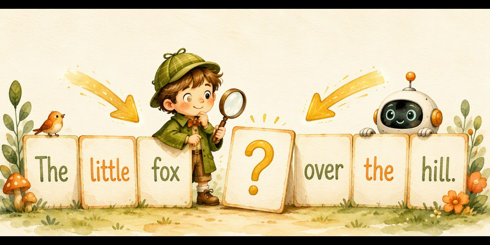

# 完形小侦探 · 前后都看看（Fill In Detective）

> 遮住一个词，前后都看看——把 BERT 的双向阅读变成孩子的完形填空游戏。

## 这是什么？

「和孩子一起学AI」社群 **AI十哲系列 · 第八课** 的配套游戏，把 2018 年谷歌的经典模型 **BERT** 变成孩子能上手玩的完形填空挑战：

- 🧩 **遮住一个词**：句子中间挖个空，前后都是线索
- 👈👉 **前后夹击**：先看左边，再看右边——这就是 BERT 的「双向阅读」
- ⚠️ **陷阱词出没**：有些词只看左边会猜错，右边一句话就把它否决！

## 怎么玩？

1. 双击打开 `index.html`（手机、电脑都行，无需联网）
2. 读句子，空格左边看看、右边看看，从三个候选词里选出真正的答案
3. 三大关卡层层升级：

- 🧩 **一眼看穿**：简单的空格，两边线索一起指认答案
- 🔍 **前后夹击**：陷阱词出没——只看左边会猜错，右边藏着翻盘的关键
- 👑 **完形侦探**：长句子、转弯词（虽然……还是……），两边的证据都要用上

4. 集齐三枚徽章 🧩🔍👑，领取「**BERT 双向阅读大师证书**」，截图发群里领奖状！

## 教育目标

- 理解 BERT 的核心直觉：**词的意思要看语境**，遮住一个词，前后一起看看才能猜回来（2018 年 BERT 靠这个横扫 11 项阅读比赛冠军）
- 迁移到学习：做阅读理解先通读全文再下笔；「断章取义」就是只看一半
- 媒介素养：惊人的话先找上下文——「这句话的上下文是什么？」

## AI十哲系列游戏

| 课次 | 论文 | 游戏 | 仓库 |
| --- | --- | --- | --- |
| 第一课 | 感知机（1957） | 人类还是AI | [human-or-ai](https://github.com/pulj26pulj26/human-or-ai) |
| 第二课 | 图像识别 | 苹果还是不是苹果 | [apple-or-not](https://github.com/pulj26pulj26/apple-or-not) |
| 第三课 | LSTM（1997） | 记忆特工队·小本本大冒险 | [memory-agent](https://github.com/pulj26pulj26/memory-agent) |
| 第四课 | ResNet（2015） | 高速公路工程师·帮AI盖大楼 | [ai-highway](https://github.com/pulj26pulj26/ai-highway) |
| 第五课 | GAN（2014） | 真假画廊·小评委大挑战 | [spot-the-fake](https://github.com/pulj26pulj26/spot-the-fake) |
| 第六课 | AlphaGo（2016） | 胜率指挥官·帮AlphaGo想下一步 | [go-commander](https://github.com/pulj26pulj26/go-commander) |
| 第七课 | 注意力机制（2017） | 焦点小侦探·带着问题找重点 | [spotlight-quest](https://github.com/pulj26pulj26/spotlight-quest) |
| 第八课 | BERT（2018） | 完形小侦探·前后都看看 | **fill-in-detective（本仓库）** |

## 本地运行

无需安装任何东西，双击 `index.html` 即可运行。也可以访问在线版：

**https://pulj26pulj26.github.io/fill-in-detective/**

---

Made with ❤️ by 和孩子一起学AI
